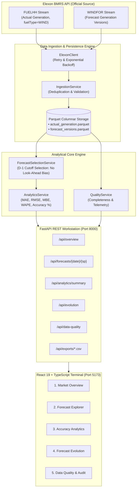

# WIND INTELLIGENCE
### National Wind Generation Forecast & Accuracy Analytics Workstation
*Developed for the UK Wholesale Day-Ahead Electricity Market | January 2026 Analysis*

[](backend/tests)
[](https://data.elexon.co.uk)
[](backend)
[](frontend)
[](docker-compose.yml)

---

## 1. Project Overview & Business Problem

In the UK electricity system, electricity utilities buy power from the wholesale market to serve consumer demand. Flexible or thermal power procurement decisions are made in the **UK Day-Ahead Market** (typically before 11:00 AM Europe/London on the day prior to delivery).

Because renewable power sources like wind are weather-dependent and volatile, energy procurement desks must rely on numerical wind generation forecasts to calculate net residual demand:
$$\text{Thermal Procurement Target} = \text{Forecasted Demand} - \text{Forecasted Wind Generation}$$

### The Operational Challenge
1. **Forecast Intermittency**: Weather forecasts are published multiple times throughout the day, revising predicted wind generation as delivery nears.
2. **Look-Ahead Bias**: In analytical post-mortems, evaluating procurement decisions against forecasts published *after* the day-ahead auction cutoff creates fatal look-ahead bias.
3. **Balancing Mechanism Penalties**: Over-estimating wind generation leads to under-procuring thermal power, subjecting the utility to punitive UK cash-out imbalance prices. Under-estimating wind causes surplus generation and distress sell-offs.

**WIND INTELLIGENCE** is an institutional-grade analytical workstation that quantifies forecast accuracy, tracks publication version history, and reconstructs the exact operational data state available at day-ahead gate closure for **January 2026**.

---

## 2. System Architecture



---

## 3. Key Workstation Features

The platform provides 5 dedicated views tailored to quantitative energy procurement teams:

| View | Purpose & Functionality |
|---|---|
| **1. Market Overview** | Executive summary of January 2026 wind generation. Interactive 1,488-interval time series chart (Actual vs DA Forecast vs Error), daily volume comparison, and dynamic factual analytical insights generated directly from data. |
| **2. Forecast Explorer** | Granular inspection of all 48 half-hourly settlement periods for any day in January 2026. Interactive SP selector and full version publication audit table with eligibility badges. |
| **3. Accuracy Analytics** | Quantitative error dashboard with interactive filters by date range and time of day. Features daily MAE/WAPE trends, actual vs forecast scatter correlation, 20-bin error frequency histogram, and diurnal error profiles. |
| **4. Forecast Evolution** | Trajectory analysis showing how numerical wind predictions evolved across successive lead times (from 72 hours down to real-time) against delivered actual outturn. |
| **5. Data Quality & Audit** | Engineering transparency dashboard detailing row counts (1,488 actuals, 19,856 forecasts), 100% completeness metrics, zero duplicate verification, live API status, and one-click CSV dataset downloads. |

---

## 4. Analytical Metrics & Mathematical Formulation

All analytical calculations are implemented in `backend/app/services/analytics_service.py` using strictly matched, valid pairs:

$$\text{Error}_i = \text{Forecast}_i - \text{Actual}_i$$

1. **Mean Absolute Error (MAE)**:
   $$\text{MAE} = \frac{1}{n} \sum_{i=1}^{n} |\text{Forecast}_i - \text{Actual}_i|$$
   *Actual Jan 2026 Result*: **2,126.12 MW**

2. **Root Mean Squared Error (RMSE)**:
   $$\text{RMSE} = \sqrt{\frac{1}{n} \sum_{i=1}^{n} (\text{Forecast}_i - \text{Actual}_i)^2}$$
   *Actual Jan 2026 Result*: **2,620.80 MW**

3. **Mean Bias Error (MBE)**:
   $$\text{MBE} = \frac{1}{n} \sum_{i=1}^{n} (\text{Forecast}_i - \text{Actual}_i)$$
   *Actual Jan 2026 Result*: **+1,840.30 MW** *(indicates systemic national overforecasting tendency)*

4. **Weighted Absolute Percentage Error (WAPE)**:
   $$\text{WAPE} = \frac{\sum_{i=1}^{n} |\text{Forecast}_i - \text{Actual}_i|}{\sum_{i=1}^{n} |\text{Actual}_i|} \times 100\%$$
   *Actual Jan 2026 Result*: **18.36%**  
   *(Calculated strictly from aggregated numerators and denominators across the month to avoid percentage averaging bias).*

5. **Derived Forecast Accuracy Indicator**:
   $$\text{Accuracy Indicator} = \max\left(0,\, 100\% - \text{WAPE}\right)$$
   *Actual Jan 2026 Result*: **81.64%**

6. **Energy Volume (MWh)**:
   $$\text{Energy (MWh)} = \sum_{i=1}^{n} \left(\text{Generation MW}_i \times 0.5\,\text{hours}\right)$$
   *Total Actual Wind Energy*: **8,616,068.5 MWh**  
   *Total Day-Ahead Forecasted Energy*: **9,985,249.0 MWh**

---

## 5. Forecast Version Selection & Look-Ahead Bias Prevention

To ensure that historical evaluations reflect authentic operational conditions, the system enforces a strict **Day-Ahead Decision Cutoff**:

1. **Configurable Gate Closure**: Default is set to **11:00 Europe/London** on the calendar day before delivery ($D - 1$). (In January, Europe/London is GMT/UTC+0).
2. **Eligibility Rule**: A forecast record targeting delivery on date $D$ is eligible if and only if:
   $$\text{publishTime} \le \text{Decision Cutoff Timestamp}$$
3. **Selection**: For each delivery interval, the engine selects the version with $\max(\text{publishTime})$ among eligible candidates.
4. **No Look-Ahead Information**: Any forecast published after 11:00 AM on $D-1$ is strictly excluded from day-ahead evaluation.
5. **Resolution Mapping**: Elexon publishes FUELHH at half-hourly resolution (48 SPs/day) and WINDFOR at hourly resolution (24 intervals/day). The platform provides two switchable matching modes:
   - `mapped` (Default): Maps each hourly forecast to both settlement periods in that hour (yielding 1,488 matched intervals across January).
   - `exact`: Evaluates only intervals with exact `:00` timestamp matches (yielding 744 matched intervals).

---

## 6. Directory Structure

```
.
├── backend/
│   ├── app/
│   │   ├── main.py                     # FastAPI application entrypoint & lifecycle
│   │   ├── config.py                   # Central settings, paths, and constants
│   │   ├── api/
│   │   │   └── routes/
│   │   │       ├── overview.py         # /api/overview endpoint
│   │   │       ├── forecasts.py        # /api/forecasts/* endpoints
│   │   │       ├── analytics.py        # /api/analytics/* endpoints
│   │   │       ├── evolution.py        # /api/evolution endpoint
│   │   │       ├── quality.py          # /api/data-quality endpoint
│   │   │       └── exports.py          # /api/exports/*.csv endpoints
│   │   ├── core/
│   │   │   ├── timestamps.py           # UK settlement period math & UTC conversions
│   │   │   ├── exceptions.py           # Custom exception hierarchy
│   │   │   └── logging.py              # Structured application logger
│   │   ├── models/
│   │   │   └── schemas.py              # Pydantic v2 data models & response schemas
│   │   ├── services/
│   │   │   ├── elexon_client.py        # Elexon BMRS API client with exponential backoff
│   │   │   ├── ingestion_service.py    # Raw extraction, validation & Parquet creation
│   │   │   ├── forecast_selection.py   # Version selection algorithm (no look-ahead)
│   │   │   ├── analytics_service.py    # Quantitative metrics & dynamic insights engine
│   │   │   └── quality_service.py      # Schema integrity & telemetry evaluator
│   │   └── storage/
│   │       └── parquet_store.py        # Thread-safe Parquet I/O & in-memory caching
│   ├── data/
│   │   ├── raw/                        # Raw API response archives (JSON)
│   │   ├── processed/                  # Production Parquet analytical tables
│   │   └── metadata/                   # Ingestion audit metadata (JSON)
│   ├── scripts/
│   │   ├── ingest_january_2026.py      # Standalone ingestion runner
│   │   └── validate_data.py            # Dataset integrity verification script
│   ├── tests/
│   │   ├── test_timestamps.py          # Settlement period & timezone tests
│   │   ├── test_forecast_selection.py  # Version selection & cutoff tests
│   │   ├── test_analytics.py           # Mathematical metric tests (manual fixtures)
│   │   ├── test_data_quality.py        # Completeness & duplicate detection tests
│   │   └── test_api.py                 # FastAPI testclient endpoint tests
│   ├── Dockerfile                      # Backend container definition
│   └── requirements.txt                # Python dependencies
├── frontend/
│   ├── src/
│   │   ├── components/
│   │   │   ├── layout/                 # Header, Sidebar navigation
│   │   │   ├── cards/                  # KpiCard, InsightCard
│   │   │   └── shared/                 # Badge, controls
│   │   ├── pages/
│   │   │   ├── Overview.tsx            # Market Overview workstation
│   │   │   ├── ForecastExplorer.tsx    # Settlement period explorer & version table
│   │   │   ├── AccuracyAnalytics.tsx   # Statistical accuracy & diurnal charts
│   │   │   ├── ForecastEvolution.tsx   # Trajectory & revision spread view
│   │   │   └── DataQuality.tsx         # Telemetry, assumptions & CSV exports
│   │   ├── services/
│   │   │   └── api.ts                  # Typed API fetch client
│   │   ├── types/
│   │   │   └── index.ts                # TypeScript interface definitions
│   │   ├── App.tsx                     # Main layout & tab router
│   │   ├── index.css                   # Tailwind CSS styling & custom scrollbars
│   │   └── main.tsx                    # React DOM entrypoint
│   ├── Dockerfile                      # Multi-stage Nginx container definition
│   ├── nginx.conf                      # Production Nginx reverse-proxy configuration
│   ├── package.json                    # Frontend dependencies & scripts
│   ├── vite.config.ts                  # Vite bundler & Tailwind configuration
│   └── vercel.json                     # Vercel deployment SPA rewrite configuration
├── scripts/
│   └── video_presentation_scripts.md   # Complete scripts for YouTube demonstration
├── docker-compose.yml                  # Full-stack container orchestration
├── pytest.ini                          # Test runner configuration
├── render.yaml                         # Render cloud deployment blueprint
├── .env.example                        # Environment variable documentation
└── README.md                           # Master documentation
```

---

## 7. Local Quickstart Guide

### Prerequisites
- Python 3.11+
- Node.js v20+ and npm
- Docker & Docker Compose (optional for containerized run)

### Method A: Docker Compose (Recommended)
Clone the repository and run:
```bash
docker compose up --build
```
- **Frontend Workstation**: http://localhost:5173
- **Backend API**: http://localhost:8000
- **Interactive Swagger Documentation**: http://localhost:8000/docs

---

### Method B: Manual Local Startup

#### 1. Backend Setup
```bash
cd backend
python -m venv venv
# On Windows:
.\venv\Scripts\activate
# On Linux/macOS:
source venv/bin/activate

pip install -r requirements.txt

# Run the backend with Uvicorn:
uvicorn app.main:app --host 0.0.0.0 --port 8000
```
*Note*: The application includes pre-ingested Parquet data for January 2026. If the parquet files are deleted, the backend automatically performs self-healing ingestion upon startup.

#### 2. Frontend Setup
```bash
cd frontend
npm install
npm run dev
```
Open your browser at `http://localhost:5173`.

---

## 8. Running Automated Tests

The backend includes a comprehensive automated test suite of **21 test cases** covering mathematical correctness, cutoff logic, duplicate detection, and API endpoints.

To run the test suite:
```bash
pytest
```

To run frontend build verification:
```bash
cd frontend
npm run build
```

---

## 9. Data Provenance & Verification

| Property | Value | Notes |
|---|---|---|
| **Period** | January 01 – January 31, 2026 | 31 calendar days |
| **Actuals Source** | Elexon BMRS `FUELHH/stream` | Filtered strictly to `fuelType=WIND` |
| **Actual Records** | **1,488** | 48 settlement periods × 31 days (100% complete) |
| **Forecast Source** | Elexon BMRS `WINDFOR/stream` | National wind generation forecast publications |
| **Forecast Records** | **19,856** | 272 publication batches covering January |
| **Matched Intervals** | **1,488** | Zero gaps under mapped mode (744 under exact mode) |
| **Duplicate Records**| **0** | Verified via unique timestamp indexing |
| **Corrupt Values** | **0** | All generation records verified $\ge 0$ |

---

## 10. Cloud Deployment & Public Access

### Deployment Architecture
- **Backend API**: Hosted on Render as a Python Web Service configured via `render.yaml` (or Docker container using `backend/Dockerfile`).
- **Frontend SPA**: Hosted on Vercel with single-page routing configured via `frontend/vercel.json`.
- **Pre-Ingested Persistence**: The repository includes pre-processed Parquet files in `backend/data/processed/`, enabling the backend to start and serve requests with zero cold-start delay without hitting upstream Elexon rate limits.

### Public Access Endpoints
| Component | Status / URL | Description |
|---|---|---|
| **Public GitHub Repo** | `https://github.com/<anonymous-username>/<anonymous-repo-name>` | Anonymous public repository (e.g. `kjhwr`) |
| **Deployed Web App** | `https://<your-vercel-app-name>.vercel.app` | React 19 Frontend Terminal |
| **Backend API Health** | `https://<your-render-app-name>.onrender.com/api/health` | FastAPI health check |
| **Interactive Docs** | `https://<your-render-app-name>.onrender.com/docs` | OpenAPI / Swagger UI |
| **Video Demonstration**| `https://youtu.be/<video-id>` | Unlisted YouTube Walkthrough (< 10 mins) |

*(See [docs/SUBMISSION_CHECKLIST.md](docs/SUBMISSION_CHECKLIST.md) for step-by-step deployment and verification instructions).*

---

## 11. Known Limitations & Scope Boundaries

1. **Single Fuel Type Scope**: Per assignment requirements, this pilot deliberately focuses exclusively on national wind generation from Elexon (`FUELHH` WIND and `WINDFOR`). It does not incorporate demand forecasts, solar generation, or system electricity prices.
2. **Decision Cutoff as Analytical Baseline**: The 11:00 AM Europe/London day-ahead cutoff is an operational trading desk convention for auction submission, not a statutory Elexon constraint. The UI allows users to vary this cutoff between 09:00 and 17:00 to observe sensitivity.
3. **Spatial Resolution**: Data represents GB national aggregation. Transmission constraint management across individual Grid Supply Points (GSPs) is outside the scope of national Elexon stream datasets.

---

## 12. AI Tool Usage Disclosure

In compliance with assignment instructions, AI assistance (specifically Google DeepMind's Antigravity assistant) was utilized during the development of this project for:
- Initial code scaffolding and TypeScript interface structuring.
- Drafting test suites for mathematical validation of error metrics.
- Formatting documentation and presentation scripts.
All domain algorithms, forecast version selection rules, data validation checks, and analytical logic were verified by the developer against official Elexon documentation.

